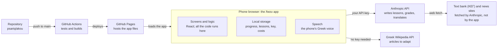

# Άκου – Greek trainer: app and build summary

As of 23 November 2026. A snapshot for handing the project to another chat; `README.md` documents every feature in more detail.

## What the app is

Άκου ("Listen!") is a phone-first web app for one learner of Modern Greek that trains reading and listening in sessions of about 10 minutes and tracks progress on the CEFR scale. The learner started at A2/B1 and asked to be reset to the beginning of A2 after the first texts felt too hard.

- **Reading:** a text of about 5 minutes at the learner's level, then about 5 minutes of questions and tasks.
- **Listening:** a 2–3 minute script read aloud by the device's Greek voice (replay allowed), then about 5 minutes of tasks.
- **Every exercise ends with a written answer**, graded by AI with corrections and a CEFR judgement.
- **Progress screen:** estimated CEFR level for reading, listening and writing, a chart over time, accuracy by task type, looked-up words, API cost by job, and the history of monthly placement tests.
- **Settings:** API key (optionally passphrase-protected), AI model, Greek voice and speed, text sources, level override, how often longer writing comes, extra practice on or off, backup export/import.

## How it's built

There is no server: the app is static files on GitHub Pages, and the browser talks directly to Anthropic's API with the learner's own key. This was chosen to avoid hosting costs.

- **Stack:** Vite 6, React 18, TypeScript; installable PWA (service worker, manifest, app icons), works offline for built-in lessons.
- **AI:** Anthropic Messages API via `@anthropic-ai/sdk` 1.8.0 from the browser (`dangerouslyAllowBrowser`). Default model Claude Opus 5.5; Sonnet 5.5 and Haiku 5.5 selectable. Structured JSON output for lessons, grading, translations and extra questions; Anthropic's web-fetch tool for graded texts and news; server-side refusal fallback on Opus and Sonnet.
- **Other network calls:** Greek Wikipedia's API, straight from the browser. Nothing else.
- **Speech:** the browser's built-in text-to-speech with a Greek voice from the phone's settings.
- **Hosting and deploy:** repository `psariq/akou`. A GitHub Actions workflow (`.github/workflows/deploy.yml`) runs the tests, builds and publishes to GitHub Pages on every push to `main`.
- **Storage:** everything (progress, lessons, translations, key) lives in the browser's local storage on the device.



Graded texts and news are fetched on Anthropic's side, because those sites don't accept requests from a browser; Wikipedia's API does.

## Content and the lesson library

Texts come mostly from officially graded material and Greek Wikipedia, adapted by AI to the learner's level; sessions start instantly from a library prepared in advance.

| Source | Licence | How it's used | Share with "Mixed" |
| --- | --- | --- | --- |
| Text bank of the Centre for the Greek Language (ΚΕΓ) | © ΚΕΓ; use for teaching and exam preparation allowed, may be simplified | Only an index (id, title, level, skill; 280 items) is in the repo. Texts are fetched on demand by Anthropic's web-fetch tool. | Reading 60%, listening 60% |
| Greek Wikipedia | CC BY-SA 4.0 | 8 built-in adapted lessons; more articles loaded at runtime and simplified | Reading 40%, listening 20% |
| AI-written texts | — | 84 built-in fictional lessons: 24 starters (A2, B1, B2) and a 60-lesson library with word translations (A2, B1), plus occasional new listening dialogues | Listening 20% |
| Current news | Publishers' copyright | Only when "News" is chosen or a link is pasted; never in the background | — |

- **Built-in lessons:** 92 in total: 8 from Wikipedia (used first), a library of 60 with word translations included (22 reading + 22 listening at A2, 8 + 8 at B1; written in Claude Code on 24 November 2026), and 24 starters. They cost nothing and work offline. None were reviewed by a native speaker.
- **1 lesson in 4 is a graded text** from the Centre's text bank (written with the API) while built-in lessons last; it is prepared one session ahead and held back until due.
- **Restock reminder:** fewer than 10 unused built-in lessons at the learner's level for a mode → a note on the Practice screen (snooze 7 days) and on the placement result after new levels are applied. Restocking steps: `docs/LIBRARY.md`.
- **Stock on the device:** when fewer than 2 unused lessons are left at the current level for a mode, the app writes new ones in the background until there are 3. At most 12 background lessons per 24 hours. This only runs while the app is open.
- **Picking a lesson:** exact level first, then at most one level away (easier preferred). Lessons are never repeated; news lessons expire after 4 days.
- **Specific source** (Graded, Wiki, News, Everyday) or a pasted link: a ready lesson from that source if there is one, otherwise it is written on the spot, which takes a few minutes.
- **Distractors** (wrong answer options) follow the style of the Greek certification exams: same theme, plausible, wrong in a detail.

## Exercises and features

Each exercise mixes comprehension, vocabulary, grammar and one written answer, with help for unknown words and extra practice where the learner is weak.

- **Task types:** main idea, details, true/false, inference, vocabulary matching, a grammar gap fill, and a short written answer.
- **"Don't know" everywhere,** so the learner never has to guess; it counts as wrong.
- **Answer positions are shuffled** each time.
- **Tap a word to translate it:** in texts and transcripts every word can be tapped. A sheet shows the dictionary form, the meaning in this text, a short grammar note and a button to hear it. Translations for a whole text are prepared in the background two lessons ahead per mode (at most 20 per 24 hours); a word without one is looked up on its own. Looked-up words are listed under Progress.
- **Extra practice:** a task type (grammar, vocabulary, details, inference) counts as weak below 60% of the last 10 answers (at least 4 answers). Exercises then get up to 2 extra questions per weak type, at most 3, made from the same text. They count for accuracy by task type but not for the exercise score or the CEFR estimate. Can be switched off.

**Writing.** Every exercise ends with a normal written answer; every 4th exercise (configurable: 3rd, 4th, 6th or never) asks for a longer one instead, at most one per sitting (exercises less than 2 hours apart). A live counter shows how many words are still needed. The ranges are the app's own choice, not official exam figures.

| Level | Normal answer | Longer answer |
| --- | --- | --- |
| A2 | 15–30 words | 40–70 words |
| B1 | 20–40 words | 70–110 words |
| B2 and above | 30–50 words | 110–160 words |

## Level estimates

Reading and listening use an Elo-style estimate from scores on level-tagged texts; writing averages the AI grader's CEFR judgements; a monthly placement test recalibrates all three. None of this is an official CEFR assessment.

**Scale.** Each skill has a number from 1 to 5.99: A1 = 1, A2 = 2, B1 = 3, B2 = 4, C1 = 5 (so 2.4 = "A2, 40% towards B1"). Start levels offered: A2 (beginning) 2.0, A2 2.3, A2/B1 2.85, B1 3.3, B1/B2 3.85, B2 4.3. The level can also be set by hand in Settings.

**After each session** (code in `src/lib/cefr.ts`), with θ = current estimate, L = the text's level, n = sessions so far for that skill:

```math
\begin{aligned}
E &= \frac{1}{1 + e^{-(1.5(\theta - L) + 0.6)}} \\
\text{step}(n) &= \max\left(0.15,\ \frac{0.45}{\sqrt{1 + n/3}}\right) \\
\theta_{\text{new}} &= \theta + \text{step}(n)\,(\text{score} - E)
\end{aligned}
```

- Texts are written for the level of θ + 0.25 (never below A2), so the expected score is about 56%.
- The step is 0.45 at the first session, about 0.32 after 3, 0.20 after 12, and 0.15 from session 24 on. Smaller steps stop lucky or unlucky texts from moving the estimate too much.
- **Known weakness:** at the 0.15 floor the estimate follows real progress slowly; about 12 sessions per skill to close half the gap to a new true level (early on, about 4). The values 0.45 and 0.15 were chosen, not calibrated on data. A possible fix (floor 0.25) was deferred until after the first placement test.

**Writing.** The grader judges which CEFR level each written answer shows; the estimate is a running average of those levels (B1 counts as 3.5), weight 1/(n+1) but never below 0.2. Longer answers count double. Rougher than reading and listening, especially above B1.

**Monthly placement test** (`src/lib/placement.ts`):

- Offered in the last 7 days of each month and, if missed, until the 7th of the next; also startable from Progress, once per month. Reading (with one longer writing task) and listening are separate parts.
- Adaptive, 2 texts per skill: text 1 at the current level; text 2 one level up if at least 60% was right, otherwise one level down. Graded text-bank texts where possible; 6 questions per text plus one extra detail and one inference question; no word help.
- Result: the level that best fits both scores under the same expected-score model (least squares), at most one level beyond what was tested. It uses only the test, not the session history; only the starting text depends on the current estimate.
- The learner chooses "Apply new levels" or "Keep current levels". Applying replaces the estimate and counts the skill as having at most 2 sessions, so the next steps are about 0.39 again.

## Costs

The learner pays for API use with prepaid Anthropic credit and reported about $4 a week on the Anthropic Console before cost tracking existed; a per-job breakdown has been collected since 19 November 2026 to decide what to cut.

| Model | Input, $ per million tokens | Output, $ per million tokens |
| --- | --- | --- |
| Claude Opus 5.5 (default) | 4.00 | 20.00 |
| Claude Sonnet 5.5 | 2.00 | 10.00 |
| Claude Haiku 5.5 (Greek quality untested) | 0.10 | 0.50 |

Web search costs $10 per 1,000 searches (news only); web fetch has no extra charge beyond tokens.

- **API calls per exercise:** writing the lesson (background or on the spot), translations for the whole text, grading the written answer, and sometimes extra questions, single-word lookups or a news search.
- **Cost tracking** (`src/lib/ledger.ts`): every API response is logged on the device with its job and estimated cost (tokens × list prices), including failed attempts and unused work. Progress → *Where the API cost goes* shows the last 7 days, this month or all tracked, cost per exercise, lessons ready but unused, and lessons dropped unused. The Anthropic Console shows the real bill.
- **Batch API (50% off) is not possible:** its endpoints refuse browser requests ("Disallowed CORS origin" for every origin tested on 19 November 2026, while the normal endpoint allows them). It would need a relay server.
- **Options considered and not taken:** hosting the app as a Claude artifact so AI use counts against the Claude plan (rejected: loses background preparation, graded texts, news and offline use); a cheaper model or less thinking for lessons, grading or translations (not without a side-by-side quality test); prompt caching (saves only cents, since most requests are unique).
- **First week of data** (19–24 November 2026, app's estimate): $3.99 in total, of which placement-test preparation $2.12, background lessons $1.35, translations $0.40, grading $0.13. The Console showed $2.45 for 20–24 November; the gap is unexplained (possibly Console reporting lag or requests made before the tracking version loaded).
- **Taken (24 November 2026):** a 60-lesson built-in library with bundled translations, written in Claude Code (counts against the Claude plan, not API credit). While it lasts, the API writes only 1 lesson in 4 (a graded text) and no translations for library lessons.

## Security and data

Without a server the API key has to live in the browser, so the design limits what a leaked key can cost and what the page can reach.

- **Damage cap:** a workspace-scoped API key with a monthly spend limit, set up in the Anthropic Console (the in-app setup guide walks through it). It can be disabled at any time.
- **Content Security Policy** in the production build: scripts only from the app itself; network connections only to `api.anthropic.com` and `el.wikipedia.org`.
- **No third-party code at runtime:** no CDNs, analytics or ads.
- **Untrusted text is never rendered as HTML;** fetched pages and AI output are shown as plain text. The key is never part of a prompt, and prompts tell the model to treat fetched pages as data.
- **Optional passphrase:** the key is stored encrypted (AES-GCM, key derived with PBKDF2-SHA-256, 600,000 iterations) and unlocked once per visit. Short PINs can still be brute-forced offline.
- **Backups** (export/import as JSON) never include the key.

**What is stored on the device** (browser local storage, prefix `akou.`):

| Key | Holds |
| --- | --- |
| `settings.v1`, `apikey.v1` | Settings; the key, plain or encrypted |
| `sessions.v1`, `progress.v1` | Completed sessions; level estimates |
| `stock.v1`, `genlog.v1` | Prepared lessons; background-generation log for the daily cap |
| `glosses.v1`, `glosslog.v1`, `lookups.v1` | Word translations; their daily-cap log; looked-up words |
| `extras.v1`, `extralog.v1` | Extra practice questions; their daily-cap log |
| `placement.v1` | Placement tests by month |
| `ledger.v1`, `dropped.v1` | API cost per request; lessons dropped unused |

## Code map, testing and workflow

The logic lives in `src/lib` (one file per concern, most with unit tests) and the screens in `src/components`.

| File | What it does |
| --- | --- |
| `src/lib/claude.ts` | All API calls: lesson writing, graded-text fetch, news, grading, extra questions, translations, lookups, error messages |
| `src/lib/prompts.ts` | All prompts: lesson rules, word ranges per level, distractor rules, grading, translations |
| `src/lib/lessonFactory.ts` | Picks a source and makes a lesson, falling back to the next source on failure |
| `src/lib/sources.ts` | Text-bank index, Wikipedia fetch, everyday topics, the source mix |
| `src/lib/library.ts` | Built-in lessons, stock, refill and picking rules, 1-in-4 graded quota, lessons left for the reminder |
| `src/lib/libraryData.ts` | Loads the library files and their bundled translations |
| `src/useRefill.ts` | Background loop: lessons, then translations, extra practice, placement texts |
| `src/lib/cefr.ts` | Level model, step sizes, target level, writing estimate |
| `src/lib/placement.ts`, `placementService.ts` | Placement window, adaptive levels, result, preparation |
| `src/lib/writing.ts` | Normal and longer writing: when, word targets, counter |
| `src/lib/practice.ts`, `practiceService.ts` | Weak areas and extra questions |
| `src/lib/glosses.ts`, `glossService.ts` | Tap-to-translate store and preparation |
| `src/lib/ledger.ts`, `pricing.ts` | Cost log by job; list prices |
| `src/lib/crypto.ts`, `storage.ts` | Key encryption; local storage and backups |
| `src/components/SessionView.tsx`, `Tasks.tsx`, `WordText.tsx`, `Player.tsx` | A session: text or audio, tasks, word sheet, results |
| `src/components/Home.tsx`, `Stats.tsx`, `LevelChart.tsx`, `SettingsView.tsx`, `PlacementView.tsx`, `Guide.tsx` | The other screens |
| `src/data/` | 60 library lessons with translations (`library/`), 24 starter lessons, 8 Wikipedia lessons, the text-bank index (rebuilt with `scripts/build-textbank-index.py`) |
| `scripts/library/` | Tools for writing library lessons: word list, merging translations, Greek spelling check |

**Testing.** `npm test` runs 245 unit tests (vitest), including format, length and translation checks for every library lesson. `e2e/smoke.mjs` drives the production build in Chromium at phone size with the API, Wikipedia and speech mocked, so it costs nothing; run it with `npm run build`, `npx vite preview --port 4173` and `node e2e/smoke.mjs`. Both passed on 24 November 2026 (e2e with the browser clock pinned to mid-month, because the placement window changes background work). Not covered by tests: the quality of real AI output, and real latency and cost.

**Workflow.**

1. Changes are made on the branch `claude/greek-learning-app-tzdwmn`.
2. Unit tests, build and the end-to-end test must pass.
3. Publishing means pushing to `main`, which deploys automatically; it happens only after the learner says so, each time.
4. Latest app change: the built-in library with translations, the 1-in-4 graded quota and the restock reminder (24 November 2026).

## Decisions, open items, and how to continue

The app is feature-complete for now; the next decisions wait on cost data with the library live and on the first placement test.

**Decisions so far** (newest first):

| Decision | Why |
| --- | --- |
| 60-lesson built-in library with translations (mostly A2, some B1), 1 lesson in 4 from the graded text bank, restock reminder below 10 | Cut API cost without lowering language quality |
| Per-job cost tracking on the Progress screen | Spend was about $4 a week with no breakdown |
| No Batch API | Its endpoints refuse browser requests |
| Stay on the API rather than move into a Claude artifact | Keeps background preparation, graded texts, news and offline use |
| Monthly adaptive placement test, result applied only on confirmation | Recalibrate levels up or down |
| Extra questions for weak task types, not counted in the score | Grammar was weak while main idea and details were at 100% |
| Word-count targets with a live countdown | Clearer than "2–3 sentences" |
| Longer writing every 4th exercise, max one per sitting | Practice longer writing while keeping sessions short |
| Writing estimate on the home screen | Every exercise already has written answers |
| Distractors rewritten to the style of the Greek certification exams | Wrong options were often off-theme |
| Shuffled answer positions | Correct answers clustered in one position |
| "Don't know" option everywhere | Avoid lucky guesses |
| Start at the beginning of A2 | First reading was very difficult |
| Tap-to-translate, prepared for built-in lessons too | Help with unknown words |
| Graded text bank and Wikipedia as main sources; new icon | Prefer official and open material over pure AI text |
| Lesson library with background refill | Writing a lesson on the spot took over 4 minutes |
| No server; the learner's own capped API key | Avoid hosting costs |

**Open items**

- [ ] Compare the weekly cost after the library is live with the first week ($3.99 app estimate).
- [ ] After the first placement test (window opens in the last 7 days of November), decide whether to raise the step-size floor from 0.15 to 0.25.
- [ ] The AI-written built-in lessons have not been checked by a native speaker.

**To continue in another chat**

1. Give it access to the repository `psariq/akou` and point it to `README.md` and this document (`docs/SUMMARY.md`).
2. Develop on `claude/greek-learning-app-tzdwmn`; push to `main` only with the learner's explicit go-ahead.
